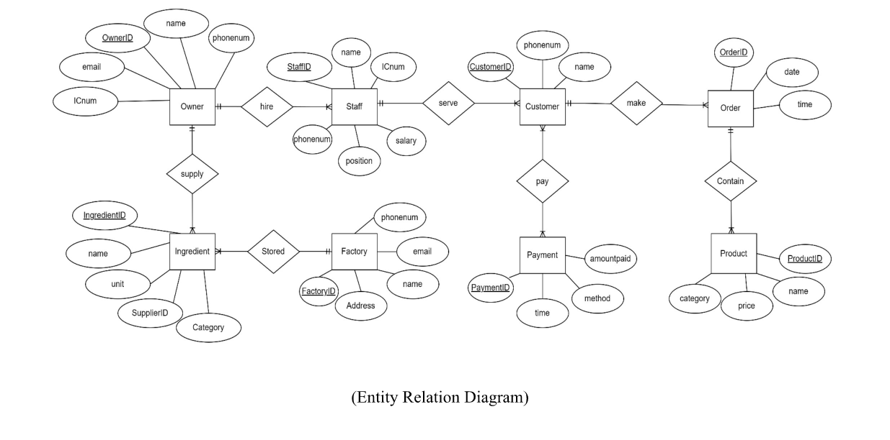

# Qulapong-Database
MySQL database for QuLapong café: ERD, tables, sample data, and SQL queries  ((By using dumb data only !!!!!!))

# QuLapong Database System

A MySQL relational database for a café/restaurant that manages owners, staff, customers, orders, payments, products, and ingredient supply.

## Features

- Relational design with 10 tables
- Primary and foreign key constraints
- Junction tables for many-to-many relationships
- Sample data inserted into all tables
- Queries using DISTINCT, LIKE, and aggregate functions (MIN, MAX, AVG)

## Entity Relationship Diagram

## Business Rules

- One owner hires one or many staff
- One owner supplies one or many ingredients
- One staff serves one or many customers
- One or many customers make one or many orders
- One or many customers pay one or many payments
- One order contains one or many products
- One or many ingredients are stored in one factory

## Database Tables

| Table | Description |
|-------|-------------|
| Owner | Business owner information |
| Staff | Employees (position, salary) linked to owner |
| Customer | Customer details linked to serving staff |
| Payment | Payment time, method, and amount |
| Orders | Order date and time, linked to customer and payment |
| Product | Menu items with price and category |
| Order_Product | Junction table: Orders and Product |
| Ingredient | Ingredients with quantity, linked to owner |
| Factory | Factory name and address |
| Ingredient_Factory | Junction table: Ingredient and Factory |

## Technologies Used

- MySQL
- SQL (DDL, DML, DQL)
- Entity Relationship Modeling

## Project Contents

- `Database_Report.pdf`: full report with ERD, CREATE TABLE statements, INSERT statements, and query results
- `erd.png`: entity relationship diagram
